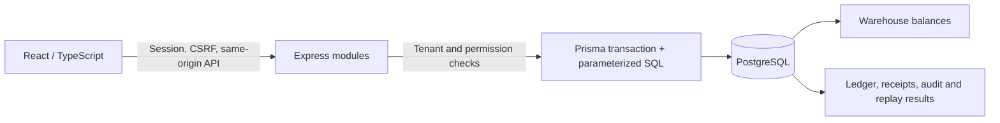

# StockFlow

**Inventory you can explain. Purchasing you can follow.**

StockFlow is a multi-tenant inventory and purchasing application for small and medium businesses. It connects warehouse stock, movement history, supplier orders and physical receipts so an operator can understand what changed and why. Its technical focus is consistency under competing operations: exact quantities, nonnegative balances, atomic transfers and receipts, and durable replay results.

This is a portfolio project with fictional data. [Open the public demo](https://stockflow-demo-qsb3.onrender.com) on Render Free with Neon Free PostgreSQL. Free hosting can sleep; allow extra time on first access. It does not represent a real distributor. Canonical identity: `SC-PROJ-STOCKFLOW`.


[Browse the real local screenshots and provenance](docs/screenshots/README.md).

## What the application does

- Organizations, session authentication and OWNER / ADMIN / MEMBER permissions.
- Products, categories, units and precision, warehouses and suppliers.
- Stock by warehouse, receipts, issues, adjustments and paired transfers.
- Purchase-order drafts, sending, cancellation and partial or full receiving.
- An operational dashboard, configured minimum-stock alerts and business audit.
- CSV product and supplier preview/confirmation, operational reports and safe CSV exports with filters and bounded pages.
- A reproducible fictional scenario for exploring the complete purchasing cycle.

The dashboard shows operational counts and recent activity. No revenue, valuation, margin or other unsupported financial metric is presented.

## Explore the local demo

The demo scenario, **Distribuidora Nova**, is a fictional distributor with products, several warehouses, suppliers, orders at different stages, stock alerts and correlated history. Public sample accounts represent each role.

Use Node 24 LTS (verified 24.14.1), npm 11 (verified 11.11.0), and PostgreSQL binaries on PATH (verified PostgreSQL 18.6).

```sh
npm ci
npm run db:start
npm run prisma:generate
npm run demo:seed
npm run demo:api
# In a second terminal:
npm run dev:web
```

Open http://127.0.0.1:5173. The API binds http://127.0.0.1:3001; Vite proxies `/api`. See [demo setup, fictional credentials and reset boundaries](docs/DEMO.md) before using `npm run demo:reset`. Reset is explicit and restricted to the dedicated marked local demo database; stop the demo API before resetting.

A useful first visit is dashboard → critical stock → inventory → purchasing → receiving → audit → imports/reports. OWNER and ADMIN can perform business operations; MEMBER explores ordinary read-only data. The interface complements server-side authorization rather than replacing it.

## Architecture and consistency

One npm workspace contains a React application and a modular Express API backed by PostgreSQL. Prisma handles the schema and ordinary scoped queries; parameterized SQL inside transactions implements conditional balance changes, row locks and integrity guards. This keeps inventory and purchasing in one transaction boundary without a queue or distributed transaction.



| Concern                | Implemented approach                                                                                             |
| ---------------------- | ---------------------------------------------------------------------------------------------------------------- |
| Exact inventory        | Decimal strings and bigint millionths; SQL numeric quantities; product-specific precision                        |
| Competing stock issues | Conditional debits and row locks; a successful write cannot leave a negative balance                             |
| Warehouse transfers    | One transaction commits source debit, destination credit and paired history                                      |
| Physical receiving     | Pending quantities are rechecked under locks; receipt, counters, stock, ledger and result commit together        |
| Retry safety           | A key binds tenant, actor and normalized intent; replay returns the durable result without repeating its effects |
| Tenant boundaries      | Scoped reads/writes and composite tenant foreign keys; cross-organization tests                                  |
| CSV confirmation       | Read-only preview followed by current-state revalidation under the shared writer lock; all-or-nothing commit     |
| Business audit         | Safe allowlisted fields, business correlation and append-only application history in the same transaction        |

See [architecture](docs/ARCHITECTURE.md), [inventory invariants](docs/INVENTORY_INVARIANTS.md) and the [portfolio case study](docs/CASE_STUDY.md) for the tradeoffs and evidence boundaries.

## Stack and layout

| Area          | Technology / location                                            |
| ------------- | ---------------------------------------------------------------- |
| Frontend      | React, TypeScript, Vite, Tailwind — `apps/web`                   |
| API           | Node.js, Express, TypeScript — `apps/api`                        |
| Database      | PostgreSQL, Prisma schema and SQL migrations — `apps/api/prisma` |
| Contracts     | Small runtime-neutral boundary — `packages/shared`               |
| Verification  | Vitest, Supertest, Playwright — workspace tests and `tests/e2e`  |
| Local tooling | Guarded PostgreSQL and demo helpers — `scripts`                  |

Versions are pinned in the manifests and lockfile. Password derivation, opaque session material and environment loading use Node built-ins.

## Development without the demo

```sh
npm ci
npm run db:start
npm run db:create
npm run db:migrate
npm run prisma:generate
npm run dev:api
# In a second terminal:
npm run dev:web
```

The helper initializes a dedicated cluster under ignored `.cache/postgres`, generates project-only credentials in ignored `.env`, and uses SCRAM on `127.0.0.1:55434`. Development uses `stockflow_dev`; destructive integration cleanup is restricted to `stockflow_test`. The demo uses `stockflow_demo`. No other project's credentials are used. `.env.example` is secret-free.

Use `npm run db:status` to inspect the cluster and `npm run db:stop` to stop it. No Windows service is registered. The health endpoint indicates process liveness; it does not prove database readiness. Production API startup expects explicit environment variables rather than the local helpers' `.env` loading.

## Testing and evidence

```sh
npm run lint
npm run format:check
npm run typecheck
npm test
npm run build
npm run prisma:validate
npm run prisma:generate
npm run db:verify-clean
npm run test:integration
# PowerShell: $env:PLAYWRIGHT_CHANNEL = 'chrome'
npm run test:e2e:db
```

Tests exercise real PostgreSQL concurrency, rollback, ledger reconciliation, tenant isolation, role restrictions, malformed CSV and authenticated browser journeys. Frontend mocks are reported separately from database evidence. `npm test` explicitly skips database cases without `TEST_DATABASE_URL`; `test:integration` loads the guarded local target. Run integration and E2E sequentially because they share the test database. Installed Chrome can be selected with `PLAYWRIGHT_CHANNEL=chrome`.

Phase 11 verification passed **334 integration cases (325 PostgreSQL + nine pure demo guards), 44 API checks without a database, 36 frontend tests and 20 real E2E journeys**. The nine guards also appear in the API count. Nine migrations were applied from an empty temporary database without schema drift; the demo was rebuilt and reused successfully. See [Phase 11 verification](docs/PHASE11_VERIFICATION.md) for executed commands, screenshot provenance, responsive/accessibility scope and remaining limits.

## Documentation and portfolio

- [Demo setup and guided visit](docs/DEMO.md)
- [Case study](docs/CASE_STUDY.md) and [Spanish / English portfolio descriptions](docs/PORTFOLIO_DESCRIPTION.md)
- [Authentication and permissions](docs/AUTHENTICATION.md), [catalog](docs/CATALOG.md)
- [Inventory](docs/INVENTORY.md), [transfers](docs/TRANSFERS.md), [purchasing](docs/PURCHASING.md), [receiving](docs/RECEIVING.md)
- [Dashboard and alerts](docs/DASHBOARD.md), [business audit](docs/AUDIT.md)
- [CSV imports](docs/IMPORTS.md), [reports and exports](docs/REPORTS.md)
- [Security boundaries](docs/SECURITY.md), [roadmap](docs/ROADMAP.md)
- [Historical Phase 10 evidence](docs/PHASE10_VERIFICATION.md) and [Phase 11 evidence](docs/PHASE11_VERIFICATION.md)

Earlier `docs/PHASE*_VERIFICATION.md` files preserve the evidence and limitations of each delivered phase. Their old feature gaps are historical context. The public repository starts from a fresh noreply publication; historical revision IDs in those reports refer to the original development history retained locally.

## Current scope and limits

Phase 11 completed the local fictional demo and commercial presentation. Phase 12 adds same-origin deployment support, public-demo registration policy, readiness, request logging and restricted SQL grants. The [public demo](https://stockflow-demo-qsb3.onrender.com) has been deployed and its HTTPS authentication, inventory/purchasing operations, CSV, tenant boundaries and restricted SQL role checked. See the exact public verification scope and remaining limits below. Source repository: [H1r0waz/StockFlow](https://github.com/H1r0waz/StockFlow). See [deployment](docs/DEPLOYMENT.md), [recovery runbook](docs/PRODUCTION_RUNBOOK.md) and [Phase 12 evidence](docs/PHASE12_VERIFICATION.md).

Public HTTPS/cookie/CSRF/Origin checks and restricted SQL privileges passed; an actual cloud dump was restored into isolated local PostgreSQL. Provider PITR/cloud failover, full proxy/IP spoofing coverage, retention, sustained workload capacity and distributed limiting remain unverified. Password reset, email verification, MFA, external notifications and financial valuation are outside this release. Audit does not resist a privileged database owner. Pending import previews and browser-held retry keys have documented restart/reload limits. Read [SECURITY.md](docs/SECURITY.md) before treating the local demo as a deployment plan.
