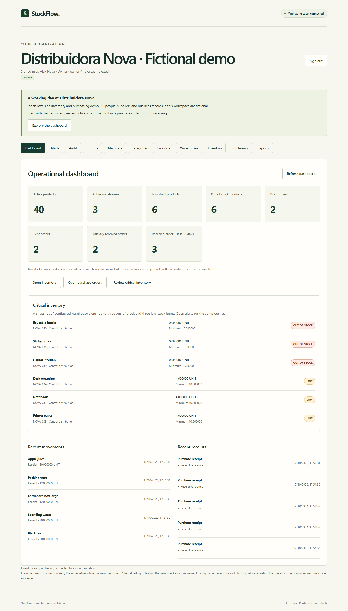

# Real local screenshots

These PNG files come from the real StockFlow application in installed Chrome,
using the isolated fictional Distribuidora Nova demo. They are raw captures,
without compositing, image generation or edits. See [MANIFEST.json](MANIFEST.json)
for timestamps, source revision, viewport and SHA-256 values.

| View                      | Screenshot                               |
| ------------------------- | ---------------------------------------- |
| Login                     | [login.png](login.png)                   |
| Dashboard                 | [dashboard.png](dashboard.png)           |
| Current stock and history | [inventory.png](inventory.png)           |
| Purchase order            | [purchase-order.png](purchase-order.png) |
| Receiving                 | [receiving.png](receiving.png)           |
| Business audit            | [audit.png](audit.png)                   |
| Read-only CSV preview     | [imports.png](imports.png)               |
| Operational reports       | [reports.png](reports.png)               |

The viewport is 1440 × 1000; full-page captures can be taller. Only fictional
records are shown. Technical UUID references identify local sample records,
not secrets. No import is confirmed while capturing the preview.
To reproduce the scenario, follow [DEMO.md](../DEMO.md), explicitly rebuild
the demo, sign in with the documented fake OWNER account and use the walkthrough.
The repeatable automated business journey is `tests/e2e/demo.spec.ts`.
